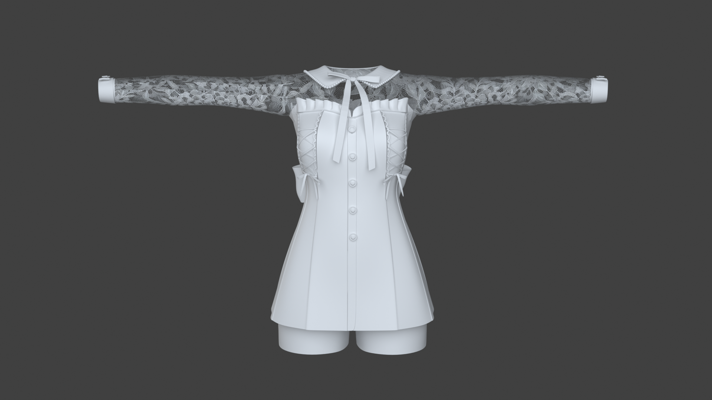
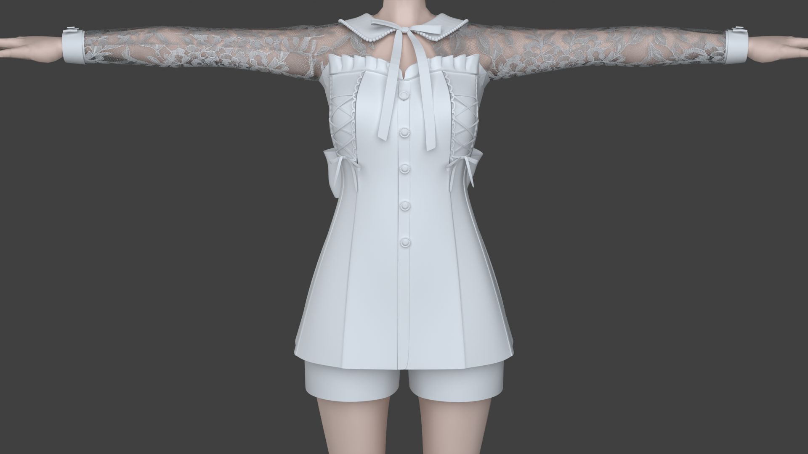

# 角色连衣裙布料模拟（Blender Cloth Gallery）

> 以 **Blender 4.5 + Cycles** 制作的布料物理模拟作品：为 VRM 动漫角色身上的连衣裙添加真实的 **Cloth 布料模拟**，实现「二次元角色 + 写实织物」的视觉融合。

## 项目简介

本项目是跟随 [YouTube 教程](https://www.youtube.com/watch?v=OGSo28XLkHM) 学习制作的成果，核心展示三点：

1. **VRM 角色的导入与使用** —— 在 Blender 中导入、驱动 VRM 动漫角色（含完整人形骨骼、弹簧骨骼、MToon 卡通着色、表情 BlendShape）。
2. **布料模拟** —— 理解 Cloth 修改器的物理参数（质量、阻尼、碰撞、固定点等），让裙子随姿态自然垂坠、摆动。
3. **卡通角色 + 写实布料的视觉融合** —— 让二次元角色与具有真实纹理 / 法线的布料在 Cycles 下自然融合。

## 成品展示

最终以 **1920 × 1080**（16:9）输出两张成品渲染图：

| 渲染成片 | 说明 |
| --- | --- |
|  | 成品渲染 1 |
|  | 成品渲染 2 |

## 技术栈

| 项 | 值 |
| --- | --- |
| 创作工具 | Blender **4.5.0** |
| 渲染引擎 | **Cycles** |
| 角色格式 | **VRM**（glTF 二进制，约 14.5 MB） |
| 角色着色器 | **MToon1**（VRM 1.0 标准卡通着色器） |
| 布料材质 | **Principled BSDF**（PBR 工作流） |
| 布料模拟 | Blender **Cloth** 修改器 |
| 输出分辨率 | 1920 × 1080 |

## 场景构成

从 `.blend` 文件解析出的场景结构：

| 元素 | 数量 |
| --- | --- |
| 对象（Object） | 22 个 |
| 网格（Mesh） | 15 个 |
| 集合（Collection） | 4 个（Scene / Character / Cloth / Shoe / Button） |
| 灯光（Light） | 3 个 |
| 相机（Camera） | 1 个 |
| 骨骼（Armature） | 1 套（VRM 完整人形骨骼 + 弹簧骨骼） |

角色由多个独立网格部件组成（`Body`、`Face`、`Hair`、`Shorts`、`Dress`、`Bow×3`、`Collar×3`、`Flower` 等），其中 **`Dress`（连衣裙）** 是布料模拟的主体，位于独立的 `Cloth` 集合中，与静态角色身体分开管理。

## 布料模拟

- 模拟对象：**`Dress`（连衣裙）**，使用 Cloth 修改器 + `ClothSimSettings` / `ClothCollSettings` 参数。
- 碰撞体：角色身体（`Body`）、短裤（`Shorts`）等作为布料的碰撞体，避免裙子穿透身体。
- 固定点：裙子在腰部 / 肩带处有固定顶点组（Pin Group），使其挂在角色身上。
- 烘焙缓存：布料模拟结果被 **烘焙缓存（Bake Cache）**，保证渲染时布料状态稳定。

## 角色系统（VRM）

- **骨骼**：Unity Mecanim 人形骨骼命名（`J_Bip_*`），另含 VRM 弹簧骨骼（头发 `J_Sec_Hair*`、胸部 `J_Sec_Bust*`）。
- **表情**：完整 VRM 表情 BlendShape（`Fcl_*`：喜怒哀乐、口型元音、眨眼等）。
- **材质**：MToon1 卡通着色器，含 Lit/Shade 二分阴影、Rim 边缘光、Outline 描边、MatCap 等通道。

## 目录结构

```
Cloth/
├── blend/
│   ├── Cloth2.blend          # 主工程文件（Blender 4.5.0，zstd 压缩）
│   └── Cloth2.blend1         # Blender 自动备份
├── Material/
│   └── Character.vrm         # VRM 角色模型
├── Texture/
│   ├── basecolor.png         # 连衣裙基础色贴图 2048×2048
│   ├── normal_map.png        # 连衣裙法线贴图 2048×2048
│   └── Flower.png            # 花饰贴图 1920×1080
├── Output/
│   ├── Cloth1.png            # 成品渲染图 1920×1080
│   └── Cloth2.png            # 成品渲染图 1920×1080
└── README.md
```

## 制作流程

1. 用 VRM Add-on 导入 `Character.vrm`，得到含骨骼、MToon 材质、表情、弹簧骨骼的完整角色。
2. 将角色部件按 `Character / Cloth / Shoe / Button` 集合分组。
3. 为 `Dress` 添加 Cloth 修改器，设置物理参数与碰撞体，烘焙布料缓存。
4. 为连衣裙创建 Principled BSDF 材质，接入 `basecolor.png` + `normal_map.png`。
5. 布置 3 盏灯 + 1 台相机，完成取景与棚拍布光。
6. 用 Cycles 以 1920×1080 输出成品图。

> 本文档中的场景结构、对象命名、材质等信息来自对 `blend/Cloth2.blend` 的解析，具体物理参数数值可在 Blender 中进一步核对。
